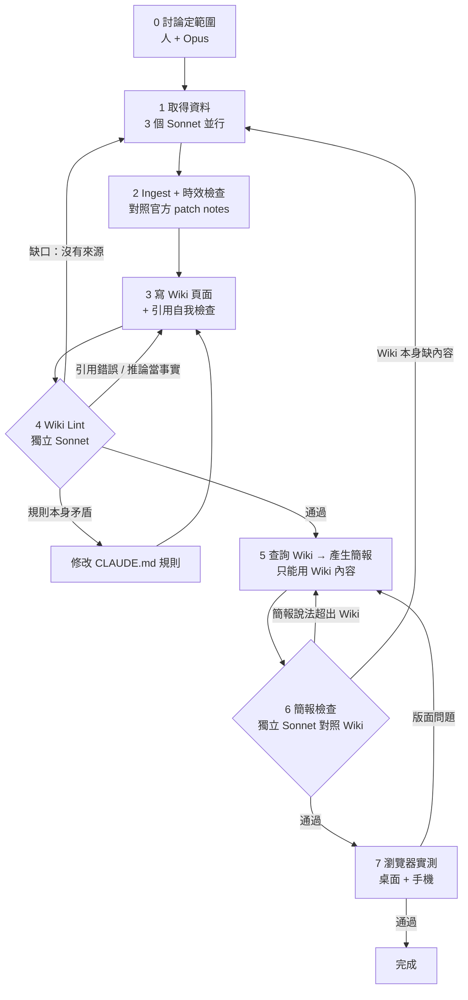

# 02 Loop / Graph 設計

## 流程圖



文字版：

```
討論 → 取得資料 → Ingest(時效檢查) → 寫 Wiki(引用自我檢查) → Wiki Lint ─┬→ 產生簡報 → 簡報檢查 ─┬→ 瀏覽器實測 → 完成
          ↑                                    ↑                    │                         │
          └──────── 缺口：回去補資料 ───────────┼────────────────────┘                         │
                                               └── 引用錯誤：重寫頁面 ←── Wiki 缺內容 ─────────┘
```

## 每個節點做什麼

| # | 節點 | 誰做 | 輸入 → 輸出 | 檢查什麼 |
|---|---|---|---|---|
| 0 | 討論定範圍 | 我 + Opus | 主題 → 分級規則、資料分工、`CLAUDE.md` | 我親自決定範圍（排除基本操作、Tap Strafe 列中階） |
| 1 | 取得資料 | 3 個 Sonnet 並行 | 搜尋 → `raw/S01–S06` | 每篇必須寫明 URL、日期、版本、疑點；不能編造 |
| 2 | Ingest + 時效檢查 | Opus | raw → 時效判斷 | 資料日期 vs 改版時間線，是否過時 |
| 3 | 寫 Wiki 頁面 | Opus | raw → `wiki/*.md` | 每句標 `[Sxx]`；衝突寫進「來源衝突」段 |
| 4 | Wiki Lint | 獨立 Sonnet | wiki + raw → lint 報告 | 引用是否真的在 raw 裡、frontmatter、斷鏈、分級 |
| 5 | 產生簡報 | Opus | wiki → `slides/index.html` | 每頁標註對應的 Wiki 頁與來源 |
| 6 | 簡報檢查 | 獨立 Sonnet | 簡報 + wiki → 檢查報告 | 簡報說法是否都在 Wiki 裡、教學順序 |
| 7 | 瀏覽器實測 | Opus + 瀏覽器 | HTML → 截圖 | 能不能瀏覽、手機版版面 |

## 哪些步驟會重複執行？
- **1 取得資料**：Wiki 出現「缺口」時重跑，只針對缺口補資料。本次實際重跑 1 次（補 Lurch、Bunny Hop → S07、S08）。
- **3 寫 Wiki ↔ 4 Lint**：lint 不通過就回去重寫，直到高、中問題清掉。
- **5 產生簡報 ↔ 6 簡報檢查**：簡報有超出 Wiki 的說法就重新生成那幾頁。
- **7 瀏覽器實測**：每次改完 HTML 都重看。

## 哪些地方需要檢查或重新生成？
1. **時效**（節點 2）：身法會被改版，社群教學常常過時 → 每篇資料都要對照 `version-history.md`。
2. **引用正確性**（節點 3、4）：LLM 寫 Wiki 時，最容易把「自己的推論」掛上來源標記。
3. **簡報忠於 Wiki**（節點 6）：生成簡報時，LLM 容易用自己的記憶補內容。
4. **版面**（節點 7）：手機版、轉場。

## 為什麼這樣設計？
- **先討論、後生成**：範圍由我決定（例如排除基本操作），避免 AI 自己決定要教什麼。
- **用 Sonnet 收資料、Opus 整理**：收資料可以並行、量大，用較便宜的模型；整理和判斷衝突需要較強的模型。
- **檢查者和寫作者分開**：Lint 和簡報檢查都交給**另一個子代理**，它只看檔案、不知道我寫作時的理由，比較不會被我的推論帶著走。這次 Lint 抓到的 3 個高嚴重度問題，都是我自己寫的時候覺得「很合理」的推論。
- **缺口回到取得資料，而不是讓模型補**：Wiki 是知識來源，模型憑記憶補上去的內容沒有來源，等於破壞整個 Wiki 的意義。
- **時效基準頁**（`version-history.md`）：給所有頁面一個共同的「現在是什麼版本」參考點。
